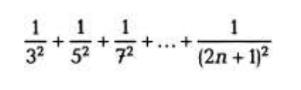
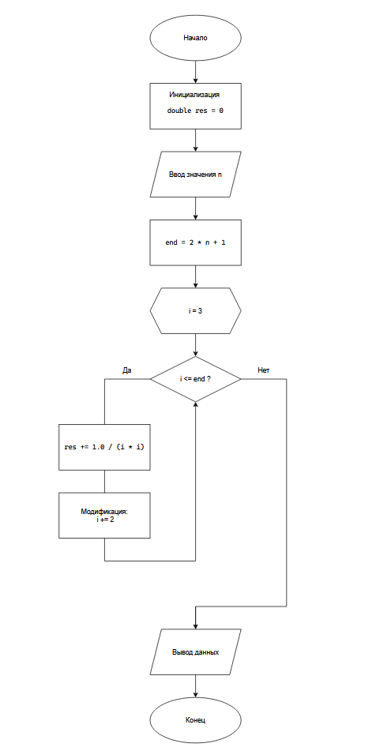

# Домашнее задание к работе 8

## Условие задачи
Вычислите с использованием цикла for значение для заданного n

 

## 1. Алгоритм и блок-схема

### Алгоритм
1. **Начало**
2. Инициализация переменной `res` = 0, для хранения результата работы программы
3. Ввод значения `n` пользователем
4. Расчет переменной `end` для определения конечного числа в цикле

   - `end` = 2 * `n` + 1

6. Цикл for() от `i` = 3 с условием выхода из цикла `i` <= `end` с шагом 2

   - Изменение переменной res, для обновления результата: `res` += 1.0 / (`i` * `i`)

7. Вывод данных
8. **Конец**

### Блок-схема
 

## 2. Реализация программы

```
#define _CRT_SECURE_NO_WARNINGS
#include <stdio.h>
#include <locale.h>

int main() {
	setlocale(LC_CTYPE, "RUS");

	int n, end;
	double res = 0;

	printf("Введите число n: ");
	scanf("%d", &n);

	end = 2 * n + 1;

	for (int i = 3; i <= end; i += 2) {
		res += 1.0 / (i * i);
	}

	printf("Результат: %lf\n", res);

	return 0;
}
```

## 3. Результаты работы программы

1. **Первый пример**
```
Введите число n: 6
Результат: 0.198047
```

2. **Второй пример**
```
Введите число n: 9
Результат: 0.208721
```

3. **Третий пример**
```
Введите число n: 901
Результат: 0.233423
```

## 4. Информация о разработчике

Лупачев Сергей бТИИ-262
